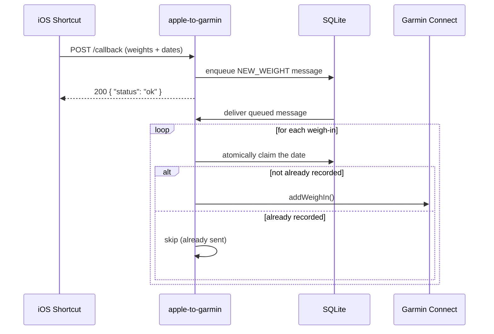

# Apple to Garmin

A tiny Node.js HTTP server that receives Apple Health weight samples from an
iOS Shortcut and forwards them to Garmin Connect, so your scale data ends up in
both places without manual re-entry.

It's built to be safe to re-run: every weigh-in is keyed by its date in SQLite,
so the same sample is never sent to Garmin twice, even if the Shortcut (or the
queue) retries.

## How it works



## Requirements

- [Node.js](https://nodejs.org/) 26+
- A Garmin Connect account
- (optional) [Docker](https://www.docker.com/), if you'd rather run the
  service in a container

## Setup

1. Install dependencies:

   ```sh
   npm install
   ```

2. Copy the example env file and fill in your Garmin credentials:

   ```sh
   cp .env.example .env
   ```

   | Variable              | Description                                          |
   | ---------------------- | ---------------------------------------------------- |
   | `GARMIN_USERNAME`       | Garmin Connect account email                          |
   | `GARMIN_PASSWORD`       | Garmin Connect account password                       |
   | `GARMIN_STORAGE_PATH`   | Folder where the Garmin session token is cached       |
   | `DATABASE_PATH`         | Path to the local SQLite database file                |
   | `CALLBACK_SECRET`       | Shared secret the Shortcut must send with every request |

3. Run the dev server:

   ```sh
   npm run dev
   ```

   The first run logs into Garmin with your credentials and caches a session
   token under `GARMIN_STORAGE_PATH`; subsequent runs reuse that session.

4. Run the tests:

   ```sh
   npm test
   ```

The new database starts empty, so the first batch may re-send dates already
sent by the Deno version.

The server listens on port `8080` and only understands one route:
`POST /callback`.

## API contract

`POST /callback` expects a JSON body with **two newline-delimited strings**
(not arrays) — this mirrors what Apple's Shortcuts app produces when you
combine a list of Health samples with a newline separator — plus a shared
`secret` that must match the server's `CALLBACK_SECRET` env var:

```json
{
  "secret": "<same value as CALLBACK_SECRET>",
  "weights": "70.55\n71.20",
  "dates": "2026-07-18T08:00:00.000Z\n2026-07-19T08:00:00.000Z"
}
```

- `secret` must exactly match the server's `CALLBACK_SECRET` env var, or the
  request is rejected before any weights are parsed or queued. This keeps
  random requests from poking the endpoint and enqueueing junk.
- `weights[i]` corresponds to `dates[i]`.
- Weight values are truncated to 5 characters and parsed as numbers, then
  sent to Garmin tagged as kilograms — make sure your Shortcut requests the
  Health sample quantity **in kilograms**, since the server doesn't do unit
  conversion.
- Dates must be strings parseable by JavaScript's `Date` constructor (ISO 8601
  works well, e.g. `2026-07-18T08:00:00.000Z`).

Responses:

| Status | Body                          | When                                  |
| ------ | ----------------------------- | -------------------------------------- |
| `200`  | `{ "status": "ok" }`          | Payload accepted and queued            |
| `401`  | `{ "error": "unauthorized" }` | `secret` missing or doesn't match      |
| `400`  | `{ "error": "no weights found" }` | `weights` missing or not a string  |
| `400`  | `{ "error": "no dates found" }`   | `dates` missing or not a string    |
| `404`  | `{ "error": "not found" }`    | Any route other than `/callback`       |

## iOS Shortcut tutorial

Create a new Shortcut (Automation or manual, your choice) with these actions,
in order:

1. **Find Health Samples where** → Type is `Weight`, adjust the date range/sort
   as needed (e.g. "Sort by Start Date, most recent first").
2. **Get Weights from Health Samples** → **Quantity**. In the quantity's unit
   options, force the unit to **Kilograms**.
3. **Combine Text** on the quantities list, using **New Line** as the
   separator. Name the resulting variable `Weights Text`.
4. Repeat steps 2–3 for the samples' **Start Date**, producing a
   `Dates Text` variable (use a consistent date format, e.g. ISO 8601).
5. **Get Contents of URL**:
   - URL: `https://<your-server-host>:8080/callback`
   - Method: `POST`
   - Headers: `Content-Type: application/json`
   - Request Body: JSON, with:
     - `secret` → the same value you set for `CALLBACK_SECRET` (hardcode it in
       the Shortcut, or read it from a Shortcuts variable so it isn't shown on
       screen when the Shortcut runs)
     - `weights` → `Weights Text`
     - `dates` → `Dates Text`

Run the Shortcut once manually to confirm you get back
`{ "status": "ok" }`, then wire it to an automation (e.g. "When Health app
data updates" or a daily time trigger) to sync automatically.

## Docker

Build the image (no compile step — it runs `node main.ts` on `node:26`):

```sh
docker build -t apple-to-garmin .
```

Run it, mounting a volume at `/data` so the Garmin session and weigh-in
history survive restarts:

```sh
docker run -d \
  --name apple-to-garmin \
  -p 8080:8080 \
  -v apple-to-garmin-data:/data \
  -e GARMIN_USERNAME=you@example.com \
  -e GARMIN_PASSWORD=your-password \
  -e CALLBACK_SECRET=a-long-random-string \
  apple-to-garmin
```

`GARMIN_STORAGE_PATH` and `DATABASE_PATH` are already set inside the image to
point at `/data`; only credentials need to be passed at `docker run` time.

The image runs as the non-root `node` user.

## Runtime

This project does not enable Node's optional Permission Model (`--permission`),
so there are no scoped allow-lists to declare in the app itself. Instead,
`npm run dev` runs with your own user's access, while the Docker image runs as
the non-root `node` user and only needs network access (for the Garmin Connect
API) plus read/write access to `/data`, where the session token and SQLite
database live.

## License

[MIT](./LICENSE.md) — do whatever you want with it. As spelled out in the
license, the software is provided "as is", with no warranty, and the authors
aren't liable for what you (or anyone you give it to) does with it or with
the data that flows through it.
